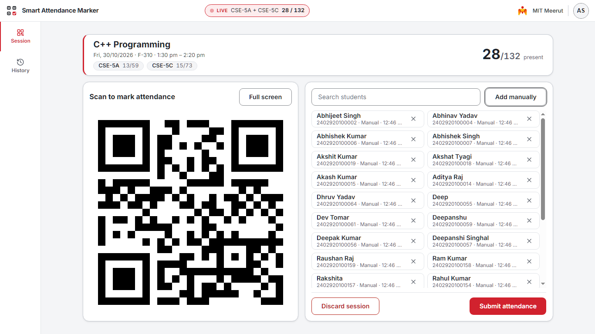
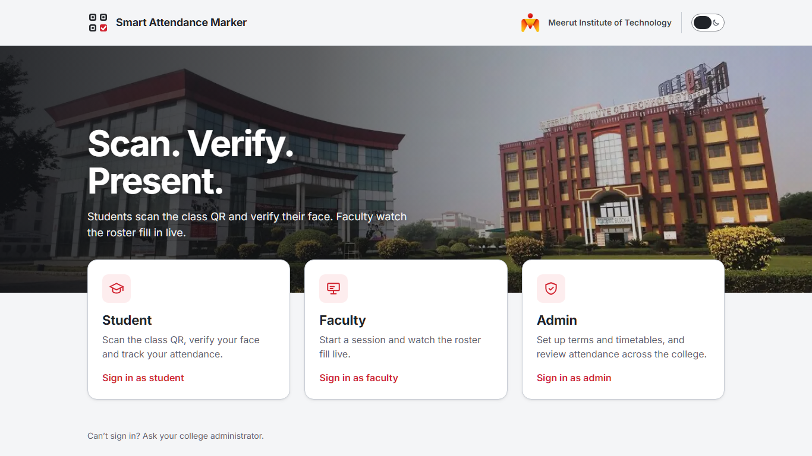
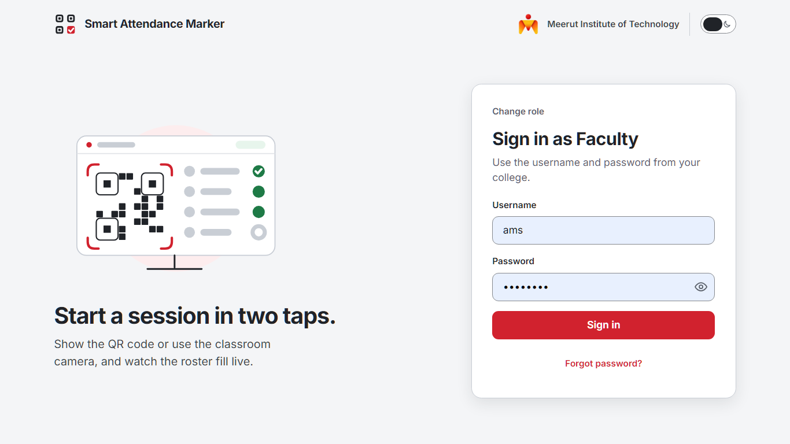
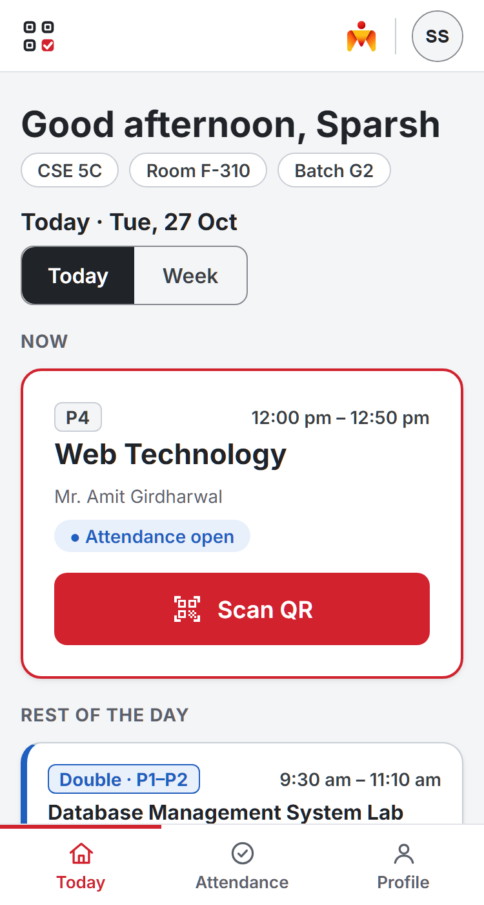
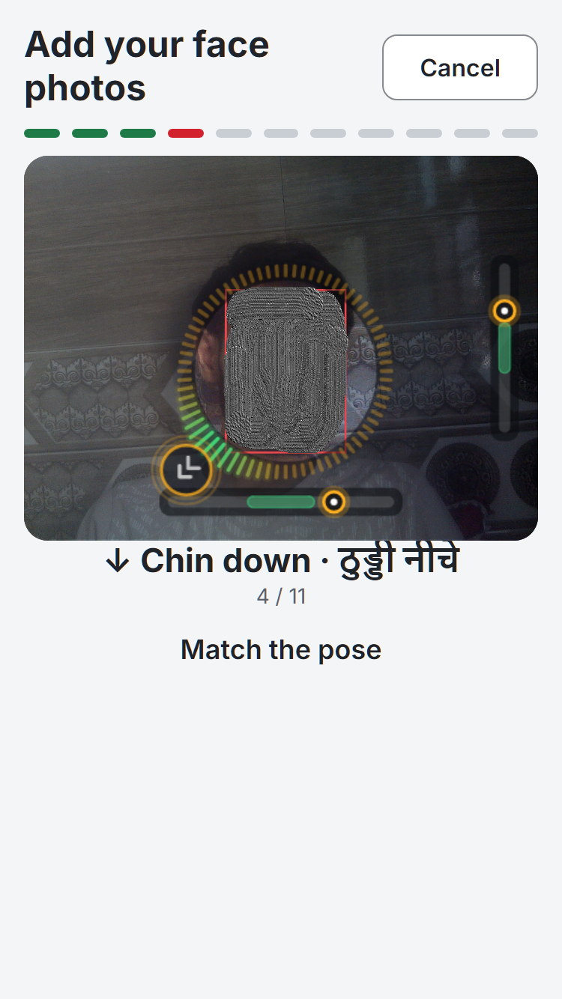
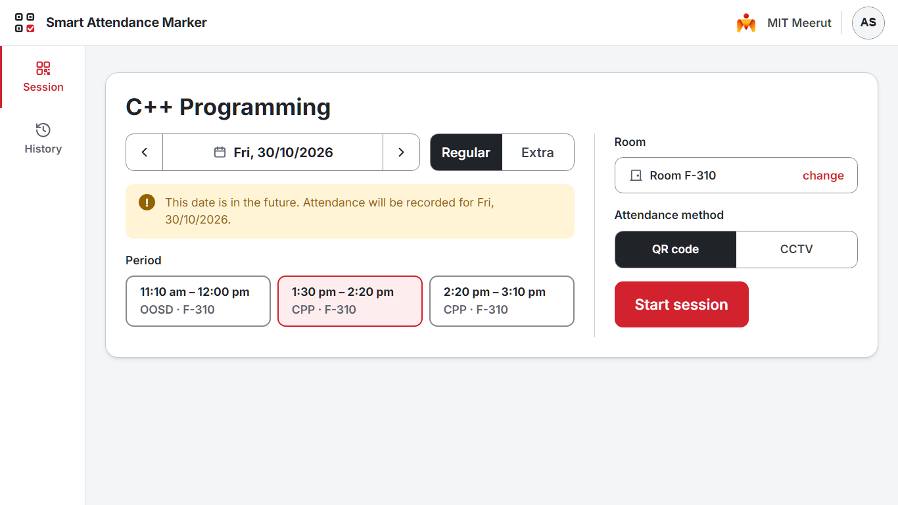
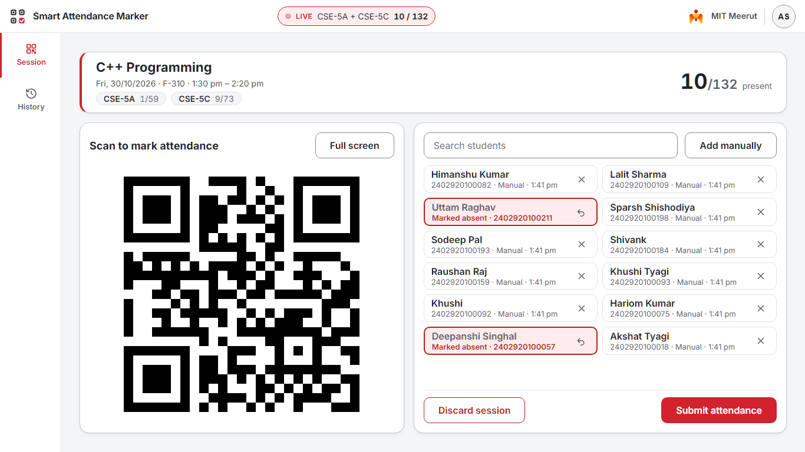
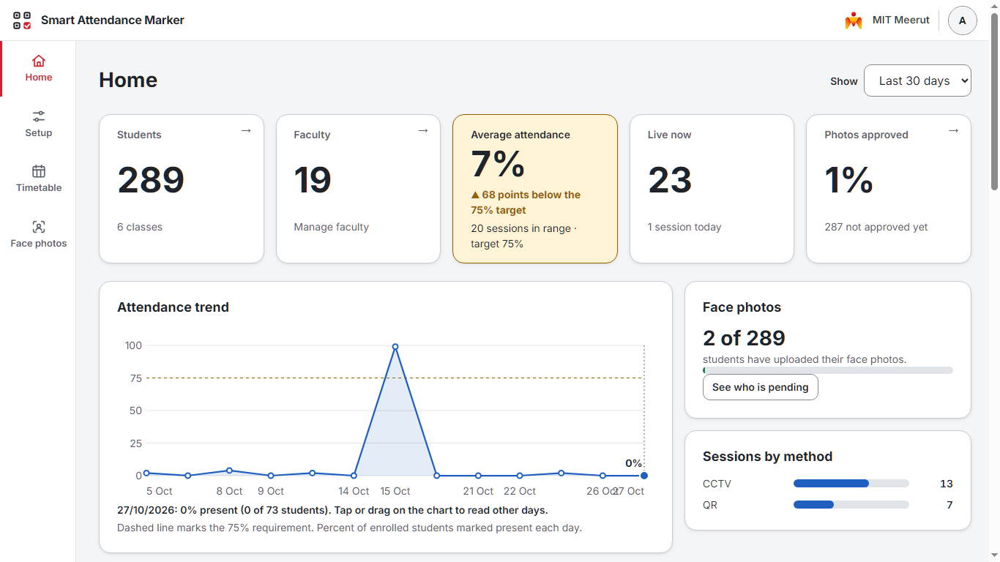
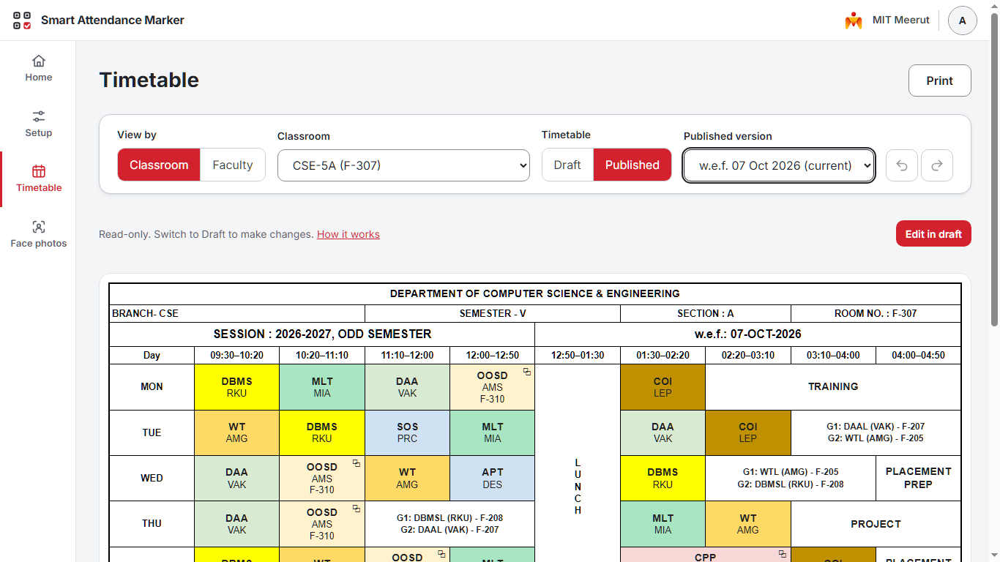

<div align="center">


# Smart Attendance Marker

**Scan. Verify. Present.**

Classroom attendance driven by the timetable: live QR codes, in-browser face verification and optional CCTV recognition.

<!-- TODO: add badges once the repo has a license and CI -->


<!-- TODO: hero GIF or screenshot (faculty live session + student scan) -->


</div>

---

## Contents

- [Features](#features)
- [How attendance is marked](#how-attendance-is-marked)
- [Screenshots](#screenshots)
- [Quick start](#quick-start)
- [Configuration](#configuration)
- [CCTV recognition (optional)](#cctv-recognition-optional)
- [Deployment](#deployment)
- [Privacy and security](#privacy-and-security)
- [License](#license)

---

## Features

### Students

- Today and Week views built from the published timetable, with double lectures shown as one block.
- Mark attendance by scanning the QR code on the classroom screen, with face verification.
- Per-subject attendance with dated records, measured against the 75% line.
- Self-service face enrolment: one photo per pose, with live guidance.
- Change password from the account menu.

### Faculty

- Start a **Regular** session from the timetable, or an **Extra** session (extra classes, borrowed periods, merged classes). Extra only offers classes the faculty member teaches.
- Live roster with the present count, QR display (full-screen presenting mode), manual add and remove.
- Discard (with confirmation) or submit a session. Every discard is logged.
- A running session survives a page refresh.
- Server-side session history with absent and present lists.

### Admin

- **Home**: analytics.
- **Setup**: term setup wizard, classrooms, rooms, subjects, faculty, students, batches.
- **Timetable**: view, create and edit in a grid, conflict detection, draft and published states, print.
- **Enrollment**: face-photo status per student (Not uploaded, Waiting for review, Approved or Rejected).
- Bulk CSV import for students, faculty and timetable.
- Reset passwords, or bulk-generate them and download a CSV.

### Platform

- Runs on the college network, with optional public access through a tunnel (ngrok, cloudflared or zrok) or Cloudflare.
- Real-time updates over Socket.io.
- SQLite storage: no database server to run.
- White-label ready: college name and logo are one config file.

---

## How attendance is marked

| Method            | What happens                                                                                                             |
| ----------------- | ------------------------------------------------------------------------------------------------------------------------ |
| **QR**            | The faculty screen shows a QR code that refreshes automatically. The student scans it from their own phone.              |
| **Camera (face)** | The browser checks the student's face before the mark is accepted: detection, liveness and recognition run on the phone. |
| **CCTV**          | An optional Python service recognizes faces from classroom camera footage and queues results for the faculty to review.  |
| **Teacher**       | The faculty member adds or removes a student manually.                                                                   |

[Attendance flow architecture](docs/ARCHITECTURE.md)

---

## Screenshots

| Homepage                                   | Login                                |
| ------------------------------------------ | ------------------------------------ |
|  |  |

| Student: Today                                       | Student: face enrolment                               |
| ---------------------------------------------------- | ----------------------------------------------------- |
|  |  |

| Faculty: session setup                               | Faculty: live session                              |
| ---------------------------------------------------- | -------------------------------------------------- |
|  |  |

| Admin: Home                                    | Admin: Timetable                                         |
| ---------------------------------------------- | -------------------------------------------------------- |
|  |  |

---

## Quick start

### Prerequisites

- [Node.js 20.12 or later](https://nodejs.org/)
- [Git](https://git-scm.com/)
- Python 3.14.x, **only** if you want CCTV recognition

### 1. Clone and install

```bash
git clone https://github.com/Malak-ul-Maut/qr-attendance.git
cd qr-attendance
npm install
```

### 2. Configure

```bash
cp .env.example .env
```

Edit `.env`. At minimum, decide on `TUNNEL` and, if you use ngrok, set `NGROK_AUTHTOKEN`. See [Configuration](#configuration).

### 3. Create the database and first admin

<!-- TODO: document how the database is created from backend/schema.sql and how the first admin account is made.
     The repo currently has no seed script and no documented bootstrap step. -->

```bash
# TODO: command to initialise the database and create the first admin
```

### 4. Start the server

```bash
npm start
```

You should see something like:

```
Connected to SQLite database
Server running at https://<your-ip>:4000
Tunnel established at: https://<your-tunnel-address>
```

The server uses a self-signed certificate, so the browser will show a warning on the local address. This is expected. The camera needs HTTPS, which is why the certificate exists.

### 5. Open it

| Address                  | Use                              |
| ------------------------ | -------------------------------- |
| `https://<your-ip>:4000` | Same Wi-Fi or LAN as the server  |
| The tunnel address       | Anywhere, if a tunnel is enabled |

Sign in from the homepage as a student, faculty member or admin.

---

## Configuration

All runtime settings are environment variables loaded from `.env` when you start the server with `npm start`.
[`.env.example`](.env.example) lists the available server, tunnel, face-enrollment and CCTV settings with their
defaults and short descriptions. Copy it to `.env`, then uncomment only the settings you want to override.

The default tunnel is ngrok and requires `NGROK_AUTHTOKEN`. CCTV recognition is optional: set `CCTV_SPAWN_SERVICE=false` to skip the Python service, or use
`CCTV_SOURCE=live` with a camera URL configured for the room to scan live footage.

---

## CCTV recognition (optional)

QR and in-browser face attendance work without this. Skip it unless you want camera-based recognition.

```bash
python -m venv venv
venv\Scripts\activate   # macOS/Linux:  source venv/bin/activate
pip install -r requirements.txt
```

<!-- TODO: add requirements.txt (fastapi, uvicorn, pydantic, onnxruntime, opencv-python, numpy, insightface, openvino ...) -->

- **Models.** The SCRFD detector and AdaFace recognizer are downloaded into `backend/models/` on first run. <!-- TODO: sizes, disk and RAM needed, and how to fetch them manually if Google Drive is blocked -->
- **Speed.** On an Intel laptop, installing `openvino` is faster than plain onnxruntime. `CCTV_BACKEND=auto` falls back automatically.
- **Memory.** The service is memory-hungry. Set `CCTV_SPAWN_SERVICE=false` when you do not need it, or run `python backend/server.py` yourself (even on another machine) and point `CCTV_SERVICE_URL` at it.
- **Source.** Use `CCTV_SOURCE=clip` with a test video while developing, and `live` for a real camera. <!-- TODO: how the camera URL is configured -->

The browser-side face check uses separate, smaller models (SCRFD-500M detector, MiniFASNet liveness, w600k_mbf recognizer) shipped in `frontend/utils/models/`.

---

## Deployment

### Option A: LAN only

Run `npm start` with `TUNNEL=none`. Everyone must be on the same network.

### Option B: tunnel

Set `TUNNEL` to `ngrok`, `cloudflared` or `zrok`. The tunnel address is printed on start. A reserved name or domain keeps it stable.

### Option C: Cloudflare for the frontend, tunnel for the API

The build outputs an optimized `frontend-dist/` folder. A Cloudflare Worker serves it and forwards `/api/*`, `/results/*` and `/socket.io/*` to your tunnel.

```bash
npm run build -- --proxy=https://<your-tunnel-address> --assets=https://cdn.jsdelivr.net/gh/<user>/<repo>@<tag>/frontend
cd pages-worker
npx wrangler@latest deploy
```

- The three large face-engine files (WASM and models) are **not** bundled. They are loaded from the CDN given in `--assets`, so tag a release and push it first, and make sure users can reach the CDN.
- Update `ORIGIN` in `pages-worker/wrangler.jsonc` to your tunnel address.
- Test the built site locally:

```bash
# Set SERVE_DIST=1 in .env, then run:
npm start
```

---

## Privacy and security

<!-- TODO: fill in after confirming with the code and your college's policy -->

- **Face data:** where enrolled photos and embeddings are stored, who can see them, how to delete a student's data.
- **Accounts:** how passwords are hashed and how sign-in tokens work. Admin tokens last 8 hours.
- **Network:** HTTPS with a self-signed certificate on the local server. CORS is open (`*`), so keep the server behind a tunnel or firewall you trust.
- **Reporting a vulnerability:** logintemporarily@gmail.com

---

## License

<!-- TODO: pick one and add a LICENSE file. package.json says UNLICENSED; the old README said MIT. -->

Created by Ahad Ali.
