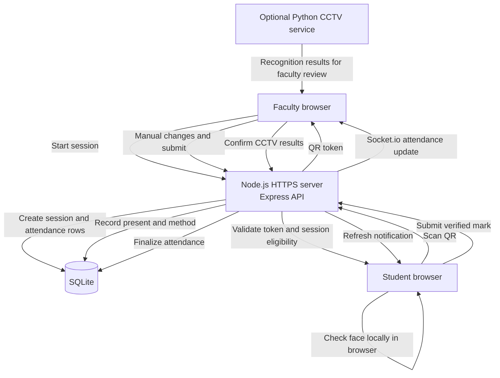
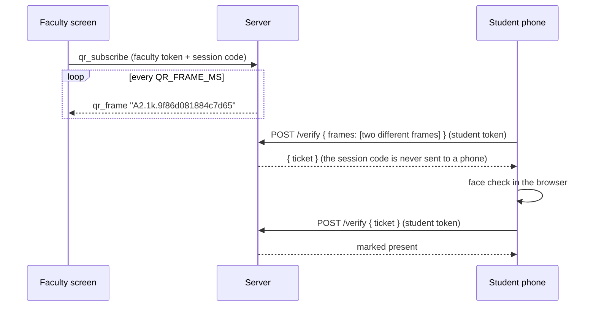

# Architecture

## Attendance flow

The Node.js server serves the frontend and API, stores session and attendance data in SQLite, and sends live updates over Socket.io. QR face checks run on the student's device; the server records the mark after the browser submits it. The optional CCTV service is separate from the QR flow, and its recognition results are reviewed by faculty before the session is finalized.

## The rotating QR

The QR is made on the server (`backend/utils/qr-feed.js`) and pushed to the faculty screen over the socket (`qr_frame`), so showing it costs one request instead of one per refresh. HTTP (`POST /api/session/token`, faculty sign-in required) is only a fallback while the socket is down.

- A frame is random text plus a sequence number. The server remembers which session it belongs to.
- Frames change every `QR_FRAME_MS` (default 400) but stay valid for `QR_FRAME_LIFETIME_MS` (default 4000), so slow Wi-Fi is fine and the lifetime never has to shrink.
- A phone must hand in `QR_FRAMES_REQUIRED` (default 2, maximum 4) different frames that were shown right after each other. A photo holds one frame, so a photo can never be redeemed. A phone pointed at the live screen sees several frames within a second.
- The student then holds a single-use ticket (6 minutes, bound to that student and session). The face check and the final request use the ticket, so a session code passed around between students is worthless.
- Not stopped: a video or burst of photos relayed within `QR_FRAME_LIFETIME_MS`, or a live camera relay. The face check, the one-phone-one-student rule and the teacher's list are the other layers.

## Keeping files on the phone

`npm run build` writes `frontend-dist/sw.js`, a service worker that stores every page, script, style, font and icon of that build on the phone. Repeat visits make almost no requests. Pages ask the network first (2.5 s) so a new deploy shows up on the next load; `/api`, `/socket.io`, `/results` and other sites are never touched. The face models are kept by the face engine in IndexedDB. The build also turns `/socket.io/socket.io.js` into a plain file of the site. Source/dev pages do not register the worker.

## Heavy files

The ONNX Runtime WASM and the face models are not in the repo. See [ASSETS.md](ASSETS.md).
