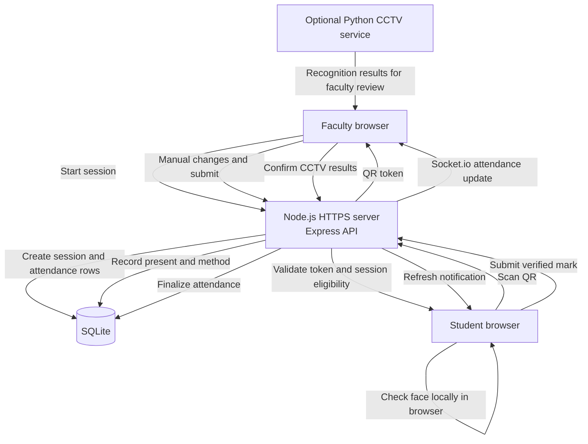

# Architecture

## Attendance flow

The Node.js server serves the frontend and API, stores session and attendance data in SQLite, and sends live updates over Socket.io. QR face checks run on the student's device; the server records the mark after the browser submits it. The optional CCTV service is separate from the QR flow, and its recognition results are reviewed by faculty before the session is finalized.
